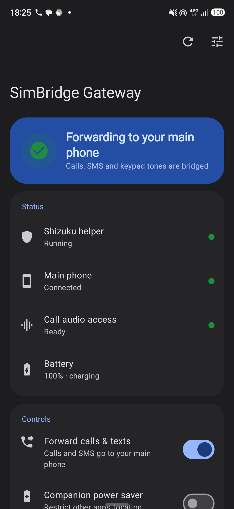
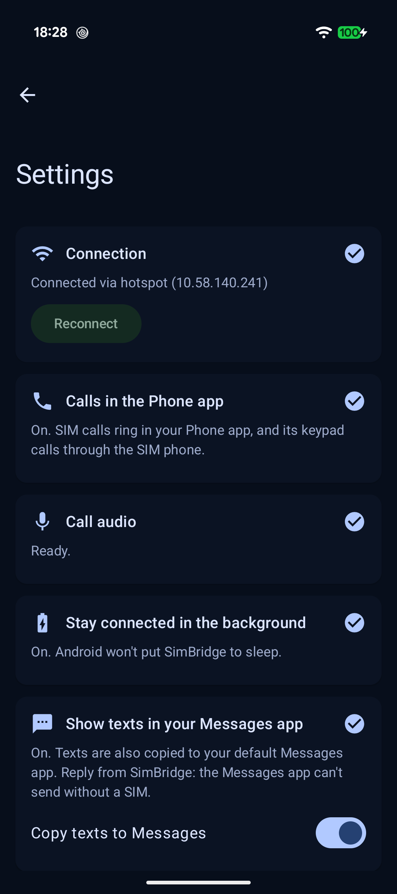
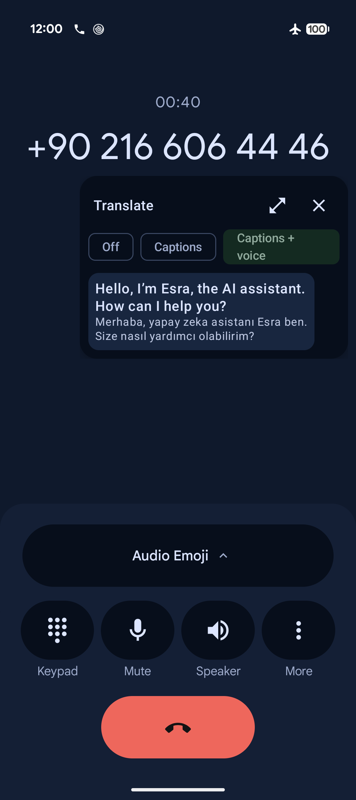
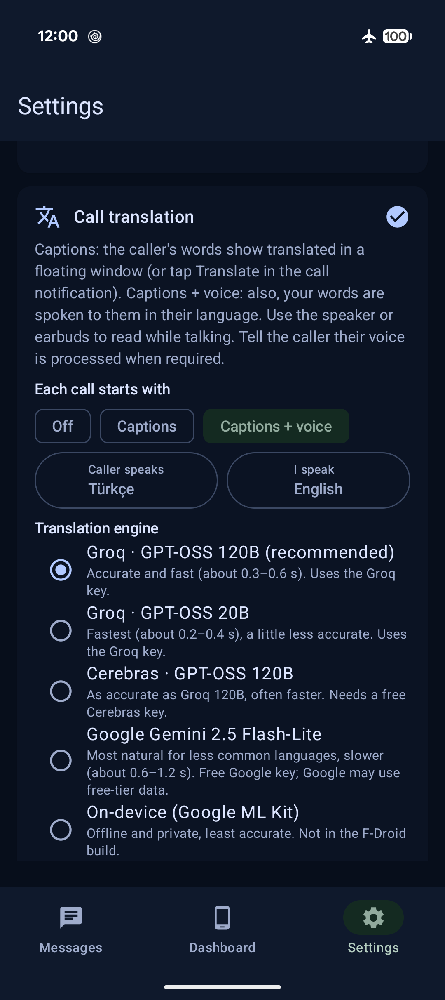

# SimBridge

**Use your phone's SIM on another phone, over Wi-Fi. No root, no server, no cloud.**

SimBridge turns an Android phone that holds a SIM card (the **SIM phone**) into a pocket gateway for a
second Android phone without a SIM (the **main phone**). Calls and texts on the SIM's number are relayed
to the main phone, and the main phone makes calls and sends texts through the SIM, either over the SIM
phone's own hotspot or over any Wi-Fi network the two phones share.

On the main phone it feels native. Calls ring in the **system Phone app** in HD voice, with its call
screen, call history, contact names and keypad. Texts, picture messages and group chats appear in a
Google Messages-style app, and can optionally be copied into your **default Messages app** too. A
**Dashboard** tab shows the SIM phone live (signal, battery, data used, hotspot devices) and controls
it remotely: network mode, APN, USSD codes, mobile data, find my phone. Everything between the phones
is **encrypted** (TLS + SRTP) and locked to the phones you paired with a QR code.

It also works beyond one Android phone: **iPhones and computers** can use the SIM through Linphone or
any SIP app, texts open in a **browser on your computer**, several main phones can ring at once, and
a VPN (Tailscale / WireGuard) makes it work **away from home**. Available in English, Arabic, Farsi,
French, Russian, Spanish and Turkish.

**New in 2.1:** tabs and the SIM phone dashboard, SIP apps (iPhone, PC), texts in a browser, carrier
voicemail, an audio self-test, 7 languages, a Google-free build, and no more lost texts while the main
phone is away. See the [changelog](CHANGELOG.md).

Talking to someone in another language? **Live call translation** shows the caller's words in your
language in a floating window during the call, and can speak your words to them in theirs: 19
languages, free cloud engines or fully on-device.

[**⬇ Download the latest release**](../../releases/latest) ·
[Get it with Obtainium](docs/stores/README.md#obtainium-works-now) ·
[Compatibility list](docs/COMPATIBILITY.md) ·
[How it works](#how-it-works) · [Setup](#setup) · [Call translation](#call-translation) · [FAQ & troubleshooting](#troubleshooting) ·
[Disclaimer](DISCLAIMER.md)

<p align="center">
  
  &nbsp;&nbsp;
  
</p>

---

## Why?

Some people want to carry one phone but can't, or don't want to, put their SIM in it. For example:

- **Your main phone can't use your local mobile network.** It may be an imported or travel phone that
  isn't registered for use in your country, or one that lacks your carrier's bands. Keep the SIM in a
  cheap, compatible phone in your bag. That phone shares its mobile data as a hotspot and relays calls
  and texts. Your main phone uses only Wi-Fi.
- **Two numbers, one phone in hand.** Leave a second line (work, home country, a local tourist SIM) in
  a spare phone and still answer it from your main phone.
- **A home line that follows you around the house.** Leave the SIM phone on a charger where reception
  is best, and use the main phone anywhere on your home Wi-Fi.

> **The motivating setup:** a SIM phone (a Samsung Galaxy A56) lives in a bag, plugged into a power
> bank, with its hotspot on. A Pixel 9 with **no SIM** joins that hotspot for internet. SimBridge rings
> the Pixel's own Phone app for calls to the SIM's number, sends texts both ways, and the A56's screen
> never turns on.

SimBridge does **not** modify IMEIs, clone SIMs, or connect the main phone to any cellular network. The
main phone only ever uses Wi-Fi. See the [disclaimer](DISCLAIMER.md).

## Features

| | |
|---|---|
| 📞 **Calls in the system Phone app** | Incoming calls ring with the normal call screen, contact name and ringtone. Outgoing calls go from the Phone app's keypad or contacts. Calls appear in the call history. |
| 🎧 **HD voice** | 16 kHz wideband audio between the phones (L16), falling back to normal phone quality (G.711) when needed. |
| 🔒 **Encrypted and paired** | Pair once by scanning a QR code. Signalling runs over **TLS** pinned to the SIM phone's key, audio over **SRTP**, and every call or text needs the paired password. Mobile-data and internet addresses are refused. |
| 💬 **Texts, pictures and group chats** | A Google Messages-style app: conversations, contact photos, bubbles, notifications with **Reply** and **Mark as read**, **Sent / Delivered** reports, picture messages (MMS) and **group texts**. |
| 📥 **System SMS integration (optional)** | Make SimBridge the **default SMS app**: "Message" buttons in Contacts and other apps open it, the Phone app's *Reply with message* sends through the SIM, and texts are saved to Android's SMS database. Or keep Google Messages as default and just copy relayed texts into it (read-only). |
| 📵 **Missed calls while offline** | Calls the SIM phone gets while the main phone is out of reach are added to the Phone app's history with a *Call back* notification. |
| 🚫 **Call blocking** | Block numbers (and hidden callers). The SIM phone rejects them before they ring. With SimBridge as the default SMS app, numbers blocked in the Phone app are included too. |
| 📶 **SIM phone dashboard** | The home screen (swipe between pages), with a live picture of the SIM phone: signal and network for every SIM, battery, **data used** today and this month, **devices on its hotspot**, **network mode** (5G/4G/3G/2G), **APN** list and new APNs, **USSD codes** with menu replies, **find my phone** (location on a map, or *Ring it*), and remote switches (battery saver, mobile data, hotspot, restart). |
| 🖥️ **Remote screen** | See and control the SIM phone from the main phone, scrcpy-style: live H.264 video, touch, keys, volume and power, optional sound, screenshots, full screen. Its own screen can stay dark. Encrypted and tamper-proof on the LAN. |
| 🏠 **Home and work Wi-Fi** | When the main phone sees a saved network, both phones move to it and the hotspot turns off; it comes back when you leave. |
| 🔑 **One-time codes** | Codes in incoming texts are copied for your keyboard, with a *Copy* button in the notification. |
| ⚡ **Speed test, widget, missed calls** | Ping and speed between the phones and to the internet; a home-screen widget with link, battery and signal; recent missed calls with call back. |
| 🍏 **iPhone and computers** | Any SIP app can use the SIM phone too: Linphone (iPhone, Mac, Windows, Linux) sets itself up from a QR code; Acrobits or Zoiper by hand. Texts also work in a **browser on your computer** (served by the main phone). |
| 📼 **Carrier voicemail** | Unanswered calls are handed back to your carrier after 15, 25 or 40 seconds, so its voicemail or call forwarding takes them. |
| 🌍 **7 languages** | English, Arabic, Farsi, French, Russian, Spanish and Turkish (main phone app). |
| 🌍 **Live call translation** | Captions of the caller's words in your language, in a floating window over the call screen. Optionally your words are spoken to them in their language. 19 languages (Turkish, English, Arabic, Persian, Russian, French, German, Spanish…). Free engines: Groq, Cerebras, Google Gemini, or on-device (Google ML Kit). See [Call translation](#call-translation). |
| 🎙️ **Call recording** | A **Record** button in the call notification, or record every call. Recordings are saved on the main phone (Recordings/SimBridge). |
| 📱📱 **Dual SIM and several main phones** | A dual-SIM gateway shows up as *SIM 1* and *SIM 2* calling accounts; texts reply on the line they came in on. Pair up to four main phones: calls ring on all of them, the first to answer gets the call. |
| ⌚ **Watch and car friendly** | Conversation notifications work on Wear OS and Android Auto (read aloud, reply by voice). |
| 💾 **Backup** | Export texts, blocked numbers and settings to a file, and import them on a new phone. |
| 🔍 **Finds the SIM phone automatically** | mDNS/DNS-SD (`_simbridge._udp`), the last address that worked, and the hotspot's gateway address. No IP addresses to type. |
| 🌙 **Quiet SIM phone** | While the main phone is connected, the SIM phone shows no call screen, its screen stays off and its call audio is muted. |
| 🔋 **Ultimate power saver** | One switch on the SIM phone turns off Bluetooth, location and scanning, and puts every other app to sleep (in seconds). Optional extras: **no sounds**, **no vibration**, **keep the screen off** and an **OLED saver** (dark theme, 60 Hz). Turning it off restores every setting exactly. |
| 🔁 **Survives reboots** | Starts by itself. Status messages ("SIM phone restarted", "Shizuku stopped", "battery low", "unplugged") arrive as texts from "SimBridge Gateway". |
| 🚫 **No root, no server** | Everything runs on the two phones. Nothing goes through the internet unless you set that up yourself. |

## How it works

```
┌────────────────────────────┐        Wi-Fi / SIM phone's hotspot        ┌─────────────────────────────┐
│  SIM phone                 │ ◄──────────────────────────────────────► │  Main phone (no SIM)        │
│  "SimBridge Gateway"       │   SIP over TLS (port 5063, pinned key)    │  "SimBridge"                │
│                            │   SRTP audio (AES-128, 16 kHz L16 / G.711)│                             │
│  cellular call ◄──► call   │   mDNS: _simbridge._udp                   │  Telecom ConnectionService  │
│  audio tap (via Shizuku)   │   INVITE / BYE / RFC 4733 DTMF            │   → system Phone app UI     │
│  SMS/MMS in/out            │   SIP MESSAGE: texts + JSON control       │  Messages-style app         │
│  built-in SIP registrar    │   (status, USSD, switches, events)        │   (+ optional copy to the   │
│                            │                                           │    system SMS database)     │
└────────────────────────────┘                                           └─────────────────────────────┘
```

- **SimBridge Gateway** (SIM phone) is a fork of
  [voice-sip-agent](https://github.com/sparkcyf/android-voice-sip-agent) in its "device-in-itself"
  configuration ([selfhost fork](https://github.com/yyano/voice-sip-agent-selfhost)). It answers and
  places cellular calls, and bridges their audio to a built-in SIP server. Android 13+ lets a
  privileged process capture and inject call audio (`CALL_AUDIO_INTERCEPTION` /
  `CAPTURE_AUDIO_OUTPUT`). [Shizuku](https://github.com/RikkaApps/Shizuku) gives the app that
  privilege, **without root**.
- **SimBridge** (main phone) registers to the gateway with the same pure-Kotlin SIP stack. It
  registers a calling account with Android's Telecom framework, so the system Phone app handles the
  call UI. Audio goes through the main phone's microphone and earpiece, with echo cancellation.
- **Pairing:** the gateway makes an EC P-256 key in the Android Keystore and shows a QR code with its
  key fingerprint and a random password. The main phone keeps both encrypted with its own Keystore
  key, accepts only that key in the TLS handshake, and proves the password (digest) on every call and
  text. The SRTP keys for each call travel inside that TLS connection (SDES, RFC 4568).
- **Control channel:** dashboard, USSD, remote switches, block lists, delivery reports and missed-call
  events are small JSON messages (`application/vnd.simbridge+json`) on the same authenticated link.

## Requirements

**SIM phone (gateway)**
- Android **13 or newer**, with a SIM, **no root needed**.
- [Shizuku](#downloads) running (wireless debugging; set once).
- The phone's audio system must allow call audio capture. Many modern phones do. It works on a
  **Samsung Galaxy A56 (Exynos 1580, Android 17, One UI)**. The upstream projects report it working
  on a Google Pixel 11 Pro (Android 17), a Motorola (Android 16) and a Nubia NX769J (Android 16). If calls connect with no sound, see
  [troubleshooting](#troubleshooting).

**Main phone**
- Android **14 or newer**. Tested on a **Google Pixel 9 (Android 17)**. The system Phone app must
  support third-party calling accounts (Google Phone does).
- Same Wi-Fi network as the SIM phone, **or** connected to the SIM phone's hotspot.
- Google Play services for the QR scanner (or paste the pairing link instead).

## Downloads

From the [latest release](../../releases/latest):

| File | Install on |
|---|---|
| `SimBridge-Gateway-<version>.apk` | the **SIM phone** |
| `SimBridge-<version>.apk` | the **main phone** |
| `SimBridge-FOSS-<version>.apk` | the **main phone**, without any Google code (pair with the camera app) |

Also on [Obtainium, IzzyOnDroid, F-Droid, Yuki and Orion Store](docs/stores/README.md).

Also needed on the **SIM phone**: **Shizuku**, either of:
- [Shizuku by thedjchi](https://github.com/thedjchi/Shizuku/releases) (**recommended**: adds *start on
  boot*, a *watchdog* and TCP mode, so it restarts by itself after a reboot), or
- the official [Shizuku by RikkaApps](https://github.com/RikkaApps/Shizuku/releases) /
  [Google Play](https://play.google.com/store/apps/details?id=moe.shizuku.privileged.api).

Optional, for setup by cable: [Android platform-tools (adb)](https://developer.android.com/tools/releases/platform-tools).

## Setup

### 1. SIM phone

1. **Enable Developer options:** Settings → About phone → Software information → tap *Build number*
   7 times.
2. **Install Shizuku** (tips per phone maker: [Shizuku setup](docs/shizuku-setup.md)) and start it with **Wireless debugging** (Shizuku shows the steps: Developer
   options → Wireless debugging → *Pair device with pairing code*, then type the code into Shizuku's
   notification). In thedjchi's Shizuku, also turn on **Start on boot** and **Watchdog**.
   - On Android 17, allow Shizuku's *notifications* and *nearby devices / local network* prompts, or
     pairing silently fails.
3. **Install `SimBridge-Gateway.apk`** and open it. Tap **Allow Shizuku access → Allow all the time**.
4. Allow every permission it asks for (phone, SMS, contacts, notifications).
5. **Make it the default phone app** when asked, or later in Settings → Apps → Default apps → Phone
   app → *SimBridge Gateway*. This lets it answer calls without the SIM phone's own call screen.
   While the main phone is not connected, it shows a simple call screen on the SIM phone.
6. Under **Security**, tap **Pair a phone**. A QR code appears (you'll scan it in step 2).
7. Optional, for picture messages and group texts: under **Picture & group messages** tap
   **Make SMS app**. Android only delivers MMS to the default SMS app. Texts reach the main phone
   either way.
8. Leave **Forward calls & texts** on and **Keep this phone silent during calls** on. Optional:
   **Companion power saver**, with its *No sounds*, *No vibration* and *Keep the screen off* options,
   for a phone that only bridges calls, texts and data.
9. Turn on **Mobile hotspot** if the main phone will use it for internet. If both phones are on the
   same Wi-Fi, you don't need the hotspot.

Recommended: Settings → Battery → set SimBridge Gateway and Shizuku to **Unrestricted**. On Samsung,
also add both to *Never sleeping apps*.

### 2. Main phone

1. **Install `SimBridge.apk`** and open it. Allow microphone, contacts, phone, notifications and
   *nearby devices / local network*.
2. Open **Settings** (⚙ in the search bar):
   - **Pair with SIM phone:** tap *Scan code* and scan the QR code from step 1.6, then confirm. (No
     Play services? Tap *Paste link* and paste the `simbridge://pair?…` link, or open that link on
     the main phone.) The status changes to **Connected via Wi-Fi** or **Connected via hotspot**.
   - **Calls in the Phone app:** tap *Open calling accounts* and turn on **SimBridge**. In Google
     Phone this is Settings → Calling accounts → All calling accounts. If the main phone has no SIM of
     its own, set SimBridge as the account to **make calls with**.
   - **Stay connected in the background:** tap *Allow* (battery optimization exemption).
   - Allow the **call log** permission when asked, so missed calls from while you were offline show
     up in the Phone app.
3. That's it. Call from the Phone app as usual, and text from SimBridge.

To use **several main phones**, scan the same QR code on each (up to four). A dual-SIM gateway adds
*SIM 1* and *SIM 2* calling accounts on the main phone: turn them on in the Phone app's calling
accounts to choose the SIM per call.

> **Upgrading from 1.x?** The connection is now encrypted, so the old password setting is gone.
> Open *Pair a phone* on the SIM phone and scan the code once on the main phone.

#### Optional: make SimBridge the default SMS app (recommended)

Settings → **Default SMS app** → *Make default SMS app*. Then:
- every "Message" / "Send SMS" button (Contacts, Phone app, other apps) opens SimBridge;
- the Phone app's **Reply with message** on an incoming call sends the text through your SIM;
- texts are saved to Android's SMS database, and Google Messages can still show them read-only.

Why not reply from Google Messages directly? On a phone without a SIM, Google Messages refuses to
send at all ("Could not start conversation"). Android offers no way for another app to send on its
behalf, so the default SMS app has to be SimBridge for replies to work everywhere.

#### Optional: keep Google Messages as default and copy texts into it

If you'd rather keep Google Messages as the default SMS app, SimBridge can still copy relayed texts
into it so you see them there (read-only). Android only lets the default SMS app write there, so run
this once from a computer with the main phone connected over USB:

```sh
adb shell appops set io.github.simbridge WRITE_SMS allow
```

Then turn on *Settings → Show texts in your Messages app → Copy texts to Messages*. Texts you
receive, and texts you send from SimBridge, then also appear in Google Messages or your default SMS
app. Deleting a conversation in SimBridge removes its copies too.

> **Replying from Google Messages doesn't work.** The main phone has no SIM, so the Messages app
> has nothing to send through. Reply from SimBridge, or from its notification.

#### Optional: set everything up over adb

Useful for scripting or headless setups. The receivers only accept broadcasts from adb (they require
the `DUMP` permission).

```sh
# SIM phone
G=io.github.simbridge.gateway/io.github.sparkcyf.voicesipagent.app.AdbControlReceiver
adb shell am broadcast -n $G --es op takeover --ez on true
adb shell cmd role add-role-holder android.app.role.DIALER io.github.simbridge.gateway 0
adb shell cmd role add-role-holder android.app.role.SMS io.github.simbridge.gateway 0   # optional: MMS
adb shell am broadcast -n $G --es op pair-link        # prints the simbridge://pair?… link
adb shell am broadcast -n $G --es op provision --ei audio_method 2   # only if calls have no audio (see below)
adb shell am broadcast -n $G --es op quiet --ei flags 7              # power-saver extras: 1 sound, 2 vibration, 4 screen
adb shell am broadcast -n $G --es op power --ez on true

# Main phone (put the link from pair-link in single quotes)
P=io.github.simbridge
adb shell "am broadcast -n $P/.ControlReceiver --es op pair --es link 'simbridge://pair?v=2&…'"
adb shell telecom set-phone-account-enabled $P/$P.GatewayConnectionService simbridge 0
adb shell telecom set-user-selected-outgoing-phone-account $P/$P.GatewayConnectionService simbridge 0
adb shell dumpsys deviceidle whitelist +$P
```

## Everyday use

- **Calls:** dial from the Phone app, contacts, or the call button in a SimBridge chat. Incoming
  calls ring like normal calls. Mute, speaker, Bluetooth and the keypad all work from the call
  screen.
- **Recording:** during a call, pull down the notification shade and tap **Record** on the
  SimBridge notification (or turn on *Settings → Call recording → Record every call*). Files are in
  *Recordings/SimBridge* and in *Settings → Call recording → Recordings*. Check your local law:
  many places require telling the other person.
- **Texts:** open SimBridge. *Start chat* picks a contact or takes a number; type several numbers
  separated by commas for a **group**. The 🖼 button adds pictures (they're resized to fit MMS
  limits). Reply straight from notifications, your watch or your car.
- **SIM phone:** *Settings → SIM phone* shows signal, battery, data and hotspot, runs **USSD codes**
  like `*100#`, and has the remote switches (*Ring it* plays a loud alarm on the SIM phone for a
  minute).
- **Blocking:** *Settings → Blocked numbers*. Blocked calls are rejected by the SIM phone and logged
  as blocked; texts from blocked numbers are dropped.
- **Backup:** *Settings → Backup → Export* saves a `.json` file (texts and pictures) you can *Import* on another phone.
- **Dashboard tab:** network mode per SIM, APNs, data used, hotspot devices, *Locate* (opens the SIM
  phone's position in Maps), *Calls → voicemail after N s*, and *Does it work on my phone?* (an audio
  test call you can share to the [compatibility list](docs/COMPATIBILITY.md)).
- **Texts on your computer:** *Settings → Texts on your computer* → turn on, open the address shown
  in a browser on the same Wi-Fi, type the 6-digit code.
- **iPhone / computer calls:** on the SIM phone, *Security → Use another SIP app* → scan the code
  with Linphone (*Assistant → Fetch remote configuration*).
- **Away from home:** see [remote access](docs/remote-access.md) (Tailscale or WireGuard).
- **Status:** the chip at the top of SimBridge shows the connection. The SIM phone texts you (as
  *SimBridge Gateway*) if it restarted, Shizuku stopped, the battery is low or it was unplugged.
- **After restarting or updating the main phone**, the first call shows *Your microphone is off for
  this call*: tap it once (Android only gives background microphone access to an app you've opened).
  Opening SimBridge once after a restart avoids it.
- **After restarting the SIM phone**, everything restarts by itself, including Shizuku with
  thedjchi's version (it needs Wi-Fi on once). You get a text when it's back.

## Limitations

- **No RCS**, and **no voicemail** relay. USSD menus that need replies (multi-step) aren't supported,
  only single codes.
- **MMS needs SimBridge Gateway as the SIM phone's default SMS app**, and mobile data on. Pictures
  and group texts aren't copied into the main phone's system SMS database (only plain texts are).
- **Google Messages can't send** without a SIM in the main phone. Reply from SimBridge (or make
  it the default SMS app).
- **No call waiting or hold** for relayed calls.
- **Local network only, unless you add a VPN.** The gateway refuses mobile-data and public addresses.
  For use away from home, follow [remote access](docs/remote-access.md).
- **iPhone SIP apps** only ring while open (iOS pauses apps without their own push service).
- **APN and hotspot switches** depend on the phone maker; some refuse them.
- The **SIM phone's own app** (SimBridge Gateway) is in English for now.
- **Hotspot remote switch is experimental**: some phones don't let apps turn the hotspot on.
- **Emergency calls** should be made from a phone with a SIM. Most phones can still place emergency
  calls without a SIM. SimBridge never handles emergency numbers.
- The SIM phone must stay **powered and in range**: it is the phone line.

## Call translation

*Main phone → Settings → Call translation.*

<p align="center">
  
  &nbsp;&nbsp;
  
</p>

1. Pick **Caller speaks** and **I speak**.
2. Paste a free **Groq** key (https://console.groq.com/keys). Groq is used for speech recognition (Whisper) and, by default, for translation.
3. Choose what each call starts with: **Off**, **Captions** (you read the caller's words in your language) or **Captions + voice** (also, your words are spoken to the caller in their language, instead of your own voice).
4. During a call, tap the floating translate button (allow *Display over other apps*) or **Translate** in the call notification. You can change the mode during the call.

| Engine | Speed | Accuracy | Key |
|---|---|---|---|
| Groq GPT-OSS 120B (default) | fast | high | Groq |
| Groq GPT-OSS 20B | fastest | a bit lower | Groq |
| Cerebras GPT-OSS 120B | fast | high | free, https://cloud.cerebras.ai |
| Google Gemini 2.5 Flash-Lite | slower | most natural for less common languages | free, https://aistudio.google.com/apikey (Google may use free-tier data) |
| On-device (Google ML Kit) | instant, offline | lowest | none (not in the FOSS build) |

Each line takes about 1–2 s after the speaker pauses. *On-device only* keeps all audio on the phone
(Android's offline recognizer + ML Kit), with lower accuracy. For **Captions + voice**, install the
caller's language under *Settings → System → Languages → Text-to-speech*. Cloud engines receive the
call's audio and text: tell the caller where the law requires it.

## Troubleshooting

| Problem | Fix |
|---|---|
| Main phone says *Looking for your SIM phone…* | Both phones on the same Wi-Fi (or main phone on the hotspot)? Is SimBridge Gateway open, with **Forward calls & texts** on? Some routers block mDNS or isolate devices: use the hotspot, or turn off "AP/client isolation". |
| *The SIM phone rejected this phone* / *key changed* | Scan the SIM phone's code again (*Pair a phone*). This is expected after *New key* on the SIM phone. After 5 wrong tries the gateway ignores that device for 10 minutes. |
| *Your microphone is off for this call* | Tap the notification once. It happens on the first call after the main phone restarted or SimBridge was updated. |
| Picture messages don't arrive | Make SimBridge Gateway the SIM phone's SMS app (*Picture & group messages*) and keep mobile data on. |
| Missed calls don't appear in the Phone app | Allow SimBridge's *call log* permission (Android settings → Apps → SimBridge → Permissions). |
| Calls connect but **no sound** | On the SIM phone: SimBridge Gateway → ⚙ (top right) → **Cellular audio** → try *Direct telephony*, then *Call redirection*. Check that Shizuku is running. |
| Calls don't ring on the main phone | Turn on the **SimBridge** calling account (main phone Settings → Calls in the Phone app). |
| No microphone after a main-phone reboot | Open SimBridge once. |
| Shizuku isn't running after a SIM-phone reboot | Use thedjchi's Shizuku with *Start on boot* + *Watchdog*, and keep Wi-Fi on. Otherwise open Shizuku and tap *Start*. |
| SIM phone screen lights up during calls | Make SimBridge Gateway the **default phone app** on the SIM phone. |
| A faint voice is still audible from the SIM phone's earpiece | Android lets the gateway mute the call-volume channel, but some phones (e.g. Samsung on Android 17) keep a minimum earpiece level the modem still drives. It's very quiet and inaudible in a bag or pocket. For total silence, plug in a wired earphone or a USB-C audio adapter with an earphone: calls then route there instead of the earpiece. The catch is that a USB-C adapter blocks charging. |
| Turning the power saver on takes a few seconds | It puts every other app to sleep, eight at a time. Wait until the switch settles. |
| Texts don't show in Google Messages | Run the `appops` command above and turn the option on. Only new texts are copied. |

## Security & privacy

- All traffic stays on your local network. SimBridge has no servers, accounts, analytics or ads.
- **Pairing** is a QR code shown on the SIM phone: it carries the gateway's key fingerprint
  (SHA-256 of its public key) and a random 20-character password. The SIM phone's private key never
  leaves its Android Keystore. The main phone stores the pairing encrypted with a Keystore key.
- **Signalling** runs over TLS 1.3 to port 5063, and the main phone accepts only the paired key, so
  an impostor on the same Wi-Fi can't pose as your SIM phone. **Audio** is SRTP
  (AES_CM_128_HMAC_SHA1_80); unencrypted calls are refused.
- **Every** call and text from a main phone carries a fresh digest answer (single-use nonce), so
  a spoofed source address can't use the SIM. In-call requests are only accepted from the phone that
  owns the call. Repeated wrong passwords are blocked.
- The gateway only accepts private LAN addresses, and only when the route back is over Wi-Fi or the
  hotspot, never mobile data. Its mDNS name is generic (`SimBridge-xxxxxx`).
- *New key* on the SIM phone unpairs every main phone at once (e.g. if one was lost).
- *Allow other SIP apps* (off by default) re-opens plain SIP/UDP on port 5062 for softphones like
  baresip. It's unencrypted: leave it off unless you need it.
- **Remote screen:** the SIM phone opens a socket only after a request over the paired TLS link,
  for one connection, with a fresh random key. The main phone proves the key, and every frame (video,
  sound, touches) is AES-GCM sealed with a counter nonce, so frames can't be read, altered or replayed
  on the Wi-Fi. The PIN for blind unlock is never stored.
- Shizuku grants powerful system access to apps you approve. Only approve apps you trust.
- Tests: `sip/src/test` checks SRTP against the RFC 3711 test vectors, tamper and replay rejection,
  pinned-TLS registration, refusal of wrong keys and passwords, forged UDP requests, HD voice and
  call forking to several phones.

## Building from source

Requirements: JDK 17, Android SDK (platform 37), and an internet connection for Gradle.

```sh
git clone https://github.com/ttabouch12/simbridge.git
cd simbridge
./gradlew :app:assembleDebug :phone:assembleDebug   # debug APKs
./gradlew :app:assembleRelease :phone:assembleRelease  # release APKs (unsigned unless configured)
```

Modules: `app` (SimBridge Gateway), `phone` (SimBridge), `sip` (pure-Kotlin SIP/RTP stack, shared),
`voice-api`, `telephony`, `privileged` (Shizuku user service), `gateway`. Release signing reads a
git-ignored `signing.properties` (`storeFile`, `storePassword`, `keyAlias`, `keyPassword`) in the
project root.

## Credits

SimBridge stands on the work of others. Thank you to:

- **[sparkcyf/android-voice-sip-agent](https://github.com/sparkcyf/android-voice-sip-agent)** (sparkcyf,
  csalinezh and contributors): the cellular ↔ SIP gateway, Shizuku privileged service, call-audio
  capture/injection, and the pure-Kotlin SIP stack used on both phones.
- **[yyano/voice-sip-agent-selfhost](https://github.com/yyano/voice-sip-agent-selfhost)** (YANO
  Yasuhiro, Hndcdr): the "device-in-itself" mode with a built-in SIP registrar, SMS relay, registrar
  authentication, and the 16 kHz/echo work.
- **[Shizuku](https://github.com/RikkaApps/Shizuku)** by RikkaApps, and the
  **[thedjchi fork](https://github.com/thedjchi/Shizuku)** (start on boot, watchdog). They're used
  through the Apache-2.0 [Shizuku-API](https://github.com/RikkaApps/Shizuku-API).
- **[baresip](https://github.com/baresip/baresip) / [baresip-studio](https://github.com/juha-h/baresip-studio)**:
  the softphone used while developing and testing the gateway.
- **[ZXing](https://github.com/zxing/zxing)** (Apache-2.0): the pairing QR code on the SIM phone.
- **Google code scanner** ([ML Kit / Play services](https://developers.google.com/ml-kit/vision/barcode-scanning/code-scanner)):
  scanning that code on the main phone, without a camera permission (not in the FOSS build).
- **[Linphone](https://www.linphone.org/)** (Belledonne Communications): its remote-provisioning
  format is used to set up SIP apps from a QR code. Linphone isn't bundled.
- Android Jetpack (Compose, Material 3, Material Icons) and Kotlin coroutines.

The full upstream commit history is kept in this repository. Upstream READMEs and docs are in
[`docs/upstream/`](docs/upstream) and [`docs/`](docs). See [`THIRD_PARTY_NOTICES.md`](THIRD_PARTY_NOTICES.md)
for licenses.

## License

**GPL-2.0-or-later** with the upstream Apache-2.0 linking exception, the same as the project it's
forked from. See [`LICENSE`](LICENSE). The software comes with **no warranty**. Read the
[disclaimer](DISCLAIMER.md).
